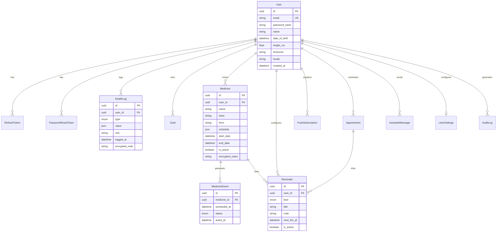

# Database Architecture: Daily Health Companion v2

## Entity Relationship Diagram

## Key Constraints & Indexes
1. `health_logs`: Indexes on `(userId, loggedAt)` and `(userId, type, loggedAt)` for sub-millisecond history and trend queries.
2. `reminders`: Partial index on `(nextFireAt, isActive)` enabling the background scheduler to claim due tasks without full table scans.
3. `goals`: Unique constraint on `(userId, type, period, isActive)` enforcing single active target per metric at database level.
4. `medicine_events`: Unique constraint on `(medicineId, scheduledAt)` guaranteeing idempotent event generation by the worker.
5. `refresh_tokens`: Family indexing on `(familyId)` for atomic multi-session tracking and instant family revocation upon detected token reuse.
